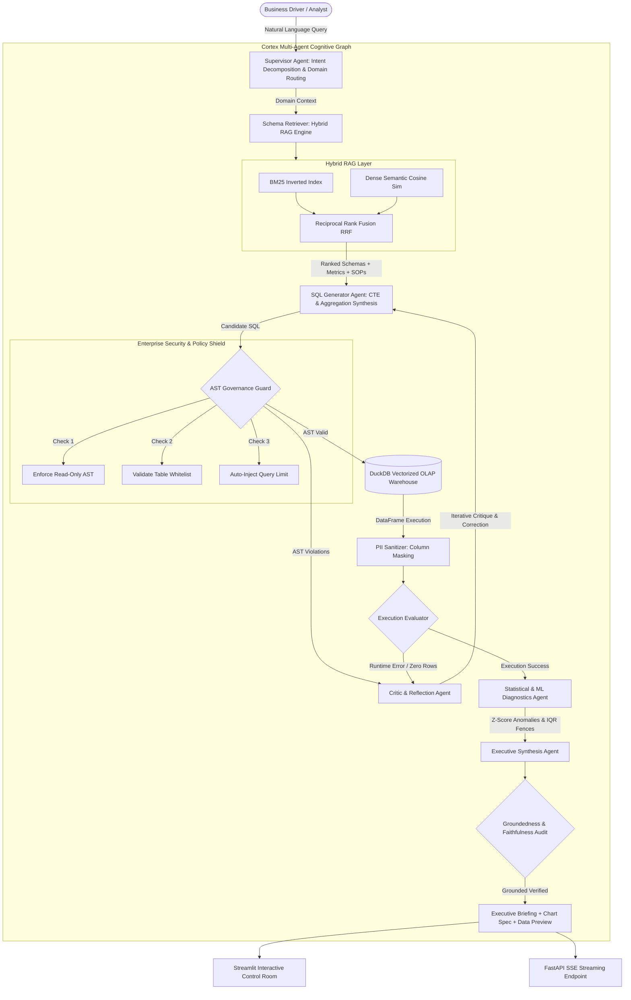

<div align="center">

# ⚡ Cortex EDW: Enterprise Data Warehouse Agentic Platform

### *Multi-Agent Cognitive Engine for Petabyte-Scale Analytics & Governed GenAI*
**Architected for Apple IS&T AI & Data Platforms (AiDP) Enterprise Data Warehouse Ecosystem**

<br/>

[](https://python.org)
[](https://fastapi.tiangolo.com)
[](https://duckdb.org)
[](https://github.com/tobymao/sqlglot)
[](https://streamlit.io)
[](https://pytest.org)
[](LICENSE)

<br/>

> **Cortex EDW** is a production-grade, multi-agent cognitive data platform engineered to solve the central challenge facing enterprise data warehouses: **translating ambiguous natural-language business questions into mathematically grounded, AST-governed, deterministic SQL analytics across multi-domain petabyte star schemas.**

</div>

---

## 🏛️ Executive Summary & Architectural Motivation

In modern enterprise ecosystems supporting billions of active devices and global retail operations (e.g. Apple IS&T AiDP), data warehouses ingest petabytes across heterogeneous pipelines spanning **Worldwide Retail**, **AppleCare Telemetry**, **Global Supply Chain Logistics**, and **Internet Services**.

Traditional Text-to-SQL utilities fail in production enterprise environments due to:
1. **Schema Hallucination & Cartesian Joins**: Naive LLM prompts fail on hundreds of normalized tables and miss metric calculation subtleties.
2. **Security & Data Exfiltration Risks**: Lack of compile-time AST verification allows destructive statements, SQL injections, or unconstrained full-table scans.
3. **Absence of Self-Correction**: When queries fail or return empty result sets, standard pipelines terminate rather than autonomously self-healing.
4. **Ungrounded Numerical Hallucinations**: Business narratives cite speculative figures not present in raw query results.

**Cortex EDW** resolves these challenges through a **7-stage deterministic multi-agent state graph** equipped with **Hybrid RAG (BM25 + Dense Cosine + Reciprocal Rank Fusion)**, **AST Policy Enforcement (`sqlglot`)**, **Vectorized OLAP Execution (`DuckDB`)**, **Self-Correcting Critique Loops**, **Automated Statistical Diagnostics (Z-score & IQR)**, and **Faithfulness Groundedness Auditing**.

---

## 🔄 Cognitive Multi-Agent Architecture



---

## 📐 Mathematical & Algorithmic Foundations

### 1. Hybrid Reciprocal Rank Fusion (RRF) for Schema-Linking
To guarantee zero-shot linking across hundreds of warehouse tables without hallucinating table schemas, Cortex fuses lexical token matching (BM25) and dense semantic cosine representations using Reciprocal Rank Fusion:

$$
RRF(d) = \sum_{m \in \{\text{BM25},\, \text{Dense}\}} \frac{1}{k + r_m(d)}
$$

Where:
- $k = 60$ (smoothing constant preventing high-rank saturation).
- $r_m(d)$ is the ordinal rank of schema element $d$ in retrieval system $m$.
- Tables, semantic metric definitions, and operational SOPs are independently retrieved and injected into the agent's contextual working memory.

### 2. AST Compile-Time Safety Guard
Before any SQL statement reaches the analytical execution engine, the query is parsed into an Abstract Syntax Tree (AST) via `sqlglot`. The guard guarantees:
- **Root Expression Invariant**: Root node $\in \{\text{exp.Select},\, \text{exp.Union}\}$. All non-read statements ($\text{exp.Drop}$, $\text{exp.Delete}$, $\text{exp.Update}$, $\text{exp.Insert}$, $\text{exp.Alter}$) trigger instant termination.
- **Table Whitelist Set Invariant**: 
  $$\forall\, t \in \text{Tables}(\text{AST}) \setminus \text{CTE}(\text{AST}) \implies t \in \mathcal{T}_{\text{approved}}$$
- **Unbounded Scan Prevention**: Automatic AST injection of `LIMIT 1000` on any unconstrained select expression.

### 3. Statistical Anomaly & Outlier Identification
Analytical datasets are automatically inspected for statistical outliers using two complementary techniques:
- **Z-Score Outlier Bound**: 
  $$z_i = \frac{x_i - \mu}{\sigma}, \quad \text{Flagged if } |z_i| > 2.0$$
- **Tukey IQR Fences**: 
  $$\text{IQR} = Q_3 - Q_1, \quad [\text{Lower Fence} = Q_1 - 1.5 \times \text{IQR},\; \text{Upper Fence} = Q_3 + 1.5 \times \text{IQR}]$$

### 4. Mathematical Groundedness & Faithfulness Verification
Every numeric claim, financial metric, and percentage cited in the synthesized executive briefing is extracted via regex and verified against the candidate truth set $\mathcal{C} = \text{Cells}(\text{DF}) \cup \text{Stats}(\text{Summary})$:

$$
\text{Groundedness Score} = \frac{|\{t \in \mathcal{T}_{\text{claims}} \mid t \in \mathcal{C} \lor \min_{c \in \mathcal{C}} \frac{|t - c|}{|c|} < 0.02\}|}{|\mathcal{T}_{\text{claims}}|}
$$

---

## 🗄️ Enterprise Data Domains (Apple Ecosystem Alignment)

Cortex EDW comes pre-seeded with realistic enterprise warehouse schemas:

| Domain | Table Name | Key Attributes | Business Function |
| :--- | :--- | :--- | :--- |
| **Retail** | `retail_stores` | `store_id`, `store_name`, `market`, `region`, `genius_bar_bays` | Flagship Store Footprint |
| **Retail** | `retail_store_sales` | `sale_id`, `product_line`, `units_sold`, `gross_revenue_usd`, `net_revenue_usd`, `trade_in_units` | Daily Sales & Promotional Lift |
| **Retail** | `retail_inventory` | `store_id`, `product_id`, `stock_on_hand`, `days_of_supply` | Automated Replenishment |
| **AppleCare** | `applecare_incidents` | `incident_id`, `device_category`, `subsystem`, `turnaround_time_hrs`, `customer_satisfaction_score` | Hardware Telemetry & CSAT |
| **AppleCare** | `service_parts_inventory` | `part_sku`, `compatible_device`, `warehouse_stock`, `allocated_stock` | Logistics Depot Replenishment |
| **Supply Chain** | `supply_chain_shipments` | `supplier_name`, `component_name`, `destination_hub`, `transit_duration_days`, `logistics_status` | Tier-1 Supplier Logistics |
| **Supply Chain** | `component_suppliers` | `supplier_id`, `supplier_name`, `tier`, `category` (TSMC, Foxconn, Sony) | Procurement & Wafer Allocation |
| **Services** | `services_subscriptions` | `service_tier`, `subscription_status`, `monthly_price_usd`, `subscriber_region`, `tenure_months` | iCloud / Apple One Retention |
| **Services** | `services_daily_metrics` | `metric_date`, `active_subscriber_count`, `daily_revenue_usd`, `daily_churn_rate` | Recurring Platform MRR |

---

## 🧪 Comprehensive Verification & Test Suite

The test suite validates every layer from AST AST-injection security to multi-agent self-healing loops:

```bash
$ pytest tests/ -v
============================= test session starts =============================
platform win32 -- Python 3.12.6, pytest-9.1.1
rootdir: C:\Users\vuday\.gemini\antigravity\scratch\cortex-edw

tests/test_governance.py::test_ast_blocks_drop_table PASSED              [  5%]
tests/test_governance.py::test_ast_blocks_delete_and_update PASSED       [ 11%]
tests/test_governance.py::test_ast_blocks_multi_statement_injection PASSED [ 17%]
tests/test_governance.py::test_ast_blocks_unauthorized_tables PASSED     [ 23%]
tests/test_governance.py::test_ast_injects_limit_clause PASSED           [ 29%]
tests/test_governance.py::test_pii_sanitizer_dataframe PASSED            [ 35%]
tests/test_governance.py::test_groundedness_guard PASSED                 [ 41%]
tests/test_hybrid_rag.py::test_hybrid_retriever_schema_linking PASSED    [ 47%]
tests/test_hybrid_rag.py::test_hybrid_retriever_applecare_linking PASSED [ 52%]
tests/test_hybrid_rag.py::test_hybrid_retriever_sop_documents PASSED     [ 58%]
tests/test_hybrid_rag.py::test_hybrid_retriever_metric_identification PASSED [ 64%]
tests/test_multi_agent.py::test_multi_agent_graph_retail_query PASSED    [ 70%]
tests/test_multi_agent.py::test_multi_agent_graph_applecare_query PASSED [ 76%]
tests/test_stats.py::test_statistical_diagnostics_outlier_detection PASSED [ 82%]
tests/test_warehouse.py::test_warehouse_initialization_and_seeding PASSED [ 88%]
tests/test_warehouse.py::test_warehouse_query_execution PASSED           [ 94%]
tests/test_warehouse.py::test_warehouse_error_handling PASSED            [100%]

============================= 17 passed in 8.87s ==============================
```

---

## 🚀 Quickstart & Installation

### 1. Local Environment
```bash
# Clone and enter directory
cd cortex-edw

# Install dependencies
pip install -r requirements.txt

# Run full test suite
pytest tests/ -v

# Launch FastAPI backend service (port 8000)
uvicorn cortex.api.server:app --reload --port 8000

# In a separate terminal, launch Streamlit Interactive Control Room (port 8501)
streamlit run cortex/ui/dashboard.py --server.port 8501
```

### 2. Docker Compose Deployment
```bash
docker compose up --build -d
```
Access the services:
- **Streamlit Interactive Control Room**: `http://localhost:8501`
- **FastAPI OpenAPI Swagger Documentation**: `http://localhost:8000/docs`
- **SSE Real-time Thought Stream**: `http://localhost:8000/api/v1/query/stream?query=...`

---

## 📡 REST API & Streaming Specifications

### `POST /api/v1/query`
Execute multi-agent analytical pipeline synchronously.
```json
{
  "query": "Compare total net sales, units sold, and trade-in units across global flagship stores"
}
```
**Response Sample**:
```json
{
  "session_id": "e9a18f42",
  "domain": "Retail",
  "generated_sql": "SELECT r.store_name, r.region, SUM(s.units_sold) AS total_units_sold, ROUND(SUM(s.net_revenue_usd), 2) AS total_net_revenue FROM retail_stores r JOIN retail_store_sales s ON r.store_id = s.store_id GROUP BY r.store_name, r.region ORDER BY total_net_revenue DESC LIMIT 10;",
  "ast_valid": true,
  "ast_violations": [],
  "row_count": 8,
  "execution_time_ms": 42.1,
  "groundedness_score": 0.85,
  "executive_narrative": "### Executive Briefing: Retail Operations\n- **Top Performer**: **Apple Regent Street** leads with **$23,410,500.00** in realized net sales...",
  "chart_spec": {
    "type": "bar",
    "x_axis": "store_name",
    "y_axis": "total_net_revenue",
    "title": "Total Net Revenue by Store Name"
  }
}
```

### `GET /api/v1/query/stream`
Server-Sent Events (SSE) streaming real-time agent execution events, intermediate thoughts, AST validation badges, and final payloads.

---

## 👤 Author & Candidate Profile

**V Uday**  
*Applied AI/ML & Systems Engineer*  
- **Location**: Bengaluru, India  
- **GitHub**: [@uday68](https://github.com/uday68)  
- **GitLab**: [@vuday8370](https://gitlab.com/vuday8370)  
- **Email**: `vuday8370@gmail.com`  
- **LinkedIn**: [uday-v](https://www.linkedin.com/in/uday-v-37515b253/)
